# 🏠 House Price Intelligence System

A project for the MCA 3rd Semester Python subject — 'Data Science
using Python' (CAPCTD3) — covering **all five units** of the syllabus,
built on Bengaluru house price data. It takes a raw listings CSV
through cleaning, preprocessing, exploratory analysis and inference,
visualization, and a trained multiple linear regression model.

## Team

- Sushil Patel
- Sonal Dhruw

## Pipeline & architecture



How it flows, with the verified numbers from the real dataset
(13,320 rows): Phase 1 drops rows with missing essentials
(13,320 → 13,303) and writes `phase1_clean.csv`; Phase 2 adds
`price_per_sqft`, removes outliers (→ 12,028), samples, then encodes
categoricals and writes `phase2_features.csv`; Phase 3 engineers
features and runs the stats/inference suite, writing
`phase3_eda.csv`; Phase 4 renders the dashboards; Phase 5 splits the
data 6953/2318/2318 (train/validation/test), fits the regressions and
writes every metric to `metrics.json`. The Streamlit app is a
separate entry point that reads cleaned data and reuses the same
modules for its charts and prediction form.

## Syllabus mapping

| Unit | What the project does | Where |
|---|---|---|
| I — Python, NumPy, Pandas | CSV loading, shape/dtypes/missing-value reports, NumPy indexing/slicing/reshaping/broadcasting on prices, `.loc`/`.iloc` selection, first cleaning pass | `src/house_price/loading.py`, `cleaning.py`, `parsing.py` |
| II — Preprocessing | Measurement levels, label + one-hot/dummy encoding, null handling, IQR & Z-score outlier filtering, mean/variance/std/covariance, Gaussian KS check, random + stratified sampling | `src/house_price/preprocessing.py` |
| III — Stats & inference | Descriptive stats, IQR, skewness, kurtosis, uni/bi/multivariate EDA, correlation, feature engineering, Bayes' theorem, Poisson/binomial distributions, CLT bootstrap CI, t-test, Z-test, one-way ANOVA | `src/house_price/eda_stats.py` |
| IV — Visualization | Matplotlib line/scatter/bar/hist/box plots with subplots; Seaborn distribution, relational, categorical plots, heatmap, pair plot, FacetGrid | `src/house_price/visualization.py` |
| V — Regression | Train/validation/test split, simple + multiple linear regression, residual plot, VIF multicollinearity check (via scikit-learn OLS), MSE & R², plus an optional KMeans market-segmentation touch | `src/house_price/modeling.py` |

## Setup

```bash
python -m venv .venv
source .venv/bin/activate
pip install -r requirements.txt
```

(A pre-built environment with the same pinned versions also works.)

## Run the pipeline

On the bundled sample (no Kaggle account needed):

```bash
python run_pipeline.py --sample
```

On the real Kaggle CSV (already included in `data/` — Kaggle's
"Bengaluru House Price Data", CC0-1.0):

```bash
python run_pipeline.py data/Bengaluru_House_Data.csv --out-dir outputs
```

Outputs (all under `outputs/`):

- `phase1_clean.csv`, `phase2_features.csv`, `phase3_eda.csv`
- `matplotlib_dashboard.png`, `seaborn_dashboard.png`, `pairplot.png`,
  `facetgrid.png`, `residual_plot.png`
- `metrics.json` — descriptive stats, hypothesis-test results, model
  metrics (MSE, R²) and every skipped analysis with its reason

## Optional Streamlit dashboard

```bash
streamlit run app.py
```

Shows three key charts and a sidebar price-prediction form with a
styled result card, using the same
cleaning/preprocessing/modelling code as the pipeline. The model is
trained on the full real dataset (12,028 listings after cleaning and
outlier filtering), so predictions reflect the real-data model
(test R² 0.541), not the tiny bundled sample.

## Run the tests

```bash
python -m pytest tests/ -q
```

Lint:

```bash
python -m ruff check src/ tests/ run_pipeline.py
```

## Parsing gotchas handled

The `total_sqft` column mixes formats, and the original plan sketch
mishandled units. This project uses the corrected conversions:

- `"1133 - 1384"` (range) → midpoint, 1258.5
- `"34.46Sq. Meter"` → 34.46 × 10.7639 ≈ 370.9 sqft (not 34.46)
- `"1200Sq. Yards"` → 1200 × 9 = 10800 sqft
- Unparseable values → NaN, counted, then dropped (never silently
  mis-converted)

## Honest limitations

- **Sample size.** The bundled sample has only 6 rows (5 after
  cleaning, 4 after outlier filtering). On it, the t-test and ANOVA
  are skipped (groups too small), VIF is skipped (fewer training rows
  than features), KMeans is skipped, and R² is `null` because a
  single test point cannot define it. All of these are recorded in
  `metrics.json` with reasons; none are faked.
- **Real Kaggle CSV verified.** The full dataset was downloaded
  from Kaggle on 2026-10-25 and run end-to-end: 13,320 → 13,303
  rows after cleaning → 12,028 after outlier filtering,
  train/validation/test 6953/2318/2318, multiple-regression test
  MSE 1915.18 and test R² 0.541. On it, the t-test, ANOVA, VIF and
  KMeans all run properly.
- **No database, auth, or API server.** The data is a local CSV and
  there are no users or external services, so those components do
  not apply to this project and were deliberately not invented.
- **No model is persisted.** The pipeline trains fresh on each run
  and reports metrics; the optional Streamlit app (`app.py`) does the
  same at startup.
